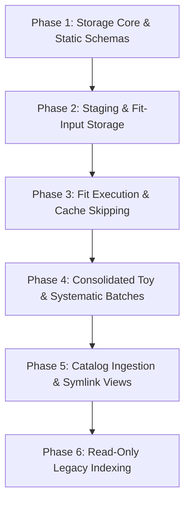

# Implementation Plan: Data Management and Artifact Store

- **Status:** Implemented in v0.6.0
- **Date:** 2026-10-17
- **Reference:** [`docs/ai/reviews/2026-10-17-data-management-review.md`](../ai/reviews/2026-10-17-data-management-review.md)
- **Related:** [`docs/todos/analysis-workflow-and-config-reorganization.md`](analysis-workflow-and-config-reorganization.md), [`docs/todos/staging-parquet.md`](staging-parquet.md), [`docs/todos/fit-data-layer.md`](fit-data-layer.md)

> **Follow-up:** v0.6 stores a complete fit input as one artifact. The separate, reusable fit-data-object layer is a follow-up plan; see [`fit-data-layer.md`](fit-data-layer.md) and the engineering [`data-layer-spec.md`](../data-layer-spec.md). Staging remains outside that follow-up scope.

---

## 1. Objective & Scope

Transition QPyM2 from path-encoded directory hierarchies (e.g. `model_{co_cut}_{ndbd_cutoff}_{co_shift}` in [`config/environments/tech_note.yaml`](../../config/environments/tech_note.yaml)) to a robust, identity-addressed **artifact store with immutable sidecar JSON manifests and a disposable SQLite query catalog**.

### Key Problems Solved
1. **Implicit path identity:** Currently, changing a model configuration while keeping the same folder naming parameters silently overwrites or reuses incompatible data.
2. **Duplicated storage:** Identical staging datasets or fit inputs shared across different model studies are re-materialized under separate model directories.
3. **Missing provenance:** Output files like `fit.h5` and `fit.nc` do not store the exact model configuration or upstream data IDs that created them.
4. **HPC filesystem bottleneck:** Thousands of independent toy fits create severe inode congestion and slow metadata operations on NERSC Community File System (CFS) and Scratch.

---

## 2. Core Architectural Decisions

### 2.1 Static Parameter Schemas (Schema-on-Write)
Rather than allowing arbitrary freeform dictionary keys in model configurations:
- **Defined dataclass schemas:** For any major campaign or software version, the model and parameter point keys are **static and declared** (e.g., via typed Python dataclasses).
- **Deterministic hashing:** Fixed field order allows trivial, deterministic SHA-256 derivation key generation without complex recursive dictionary sorting or type normalization.
- **Fail-fast validation:** Typos in configuration parameters (e.g. `co_cuts` vs `co_cut`) fail immediately during plan validation rather than launching invalid multi-hour SLURM array jobs.
- **Relational SQL indexing:** Core physical parameters map directly to typed, indexed SQLite columns (`co_shift REAL`, `ndbd_cutoff TEXT`), enabling instant SQL queries without parsing raw JSON blobs.
- **Versioned schema evolution:** When a campaign introduces new physical degrees of freedom, the schema version increments explicitly (`schema_version: 2`).

### 2.2 Separation of Scientific Derivation Key vs. Execution Metadata
Decouple cache reuse from execution auditability:
- **Scientific Derivation Key (`artifact_id`):**
  - Generated from: `hash(artifact_type, schema_version, upstream_content_ids, static_operation_params)`.
  - Determines cache hits and task skipping.
  - Does **not** include human labels (`model_key`), git commit hash, dirty working tree status, or execution timestamp.
- **Execution Metadata (`execution_metadata`):**
  - Stored inside the sidecar `manifest.json` and catalog records.
  - Records: `execution_id` (UUID), `git_commit`, `git_dirty` boolean, host/environment, SLURM job ID, random seed, and execution timestamp.
  - **Benefit:** Editing a script for logging, docstrings, or plotting does not invalidate existing expensive fits, while full scientific provenance is retained.

The hash-based ID and sidecar details above describe the implemented v0.6 contract. For new fit-data objects and sets, the follow-up specification uses reversible, versioned identity profiles with defaults and embeds canonical metadata in HDF5/NetCDF files. Existing v0.6 IDs and sidecars remain readable; see [`docs/data-layer-spec.md`](../data-layer-spec.md).

### 2.3 Consolidated Storage for Toys and Systematics
Avoid the "small-file / inode explosion" problem on NERSC CFS/Scratch:
- **Default to Results-Only:** For 95%+ of toy Monte Carlo and systematic scans, full posterior chains are unnecessary. The pipeline extracts summary metrics (median, credible intervals, $\hat{R}$, ESS, pull/bias) and appends them to a **single consolidated file** per batch (`results.parquet` or `results.h5`).
- **Bundled Traces when Required:** If full MCMC samples must be retained for diagnostics, combine all traces into a **single multi-toy file** (e.g. NetCDF with an indexed `toy_index` dimension or HDF5 group hierarchy) instead of hundreds of separate `.nc` files.
- **Granularity rule:**
  - *Nominal single fits:* 1 artifact bundle per fit (holding `fit.h5`, `fit.nc`, `manifest.json`).
  - *Toy studies:* 1 artifact bundle **per batch**, containing the consolidated table and a batch manifest.

### 2.4 HPC Concurrency & Disposable SQLite Catalog
- **No concurrent SQLite writes from workers:** SQLite WAL mode does not work reliably across networked filesystems. SLURM array workers must **never** write directly to a shared `catalog.sqlite`.
- **Worker isolation:** Each worker writes to a private temporary directory, writes the payload and `manifest.json`, and atomically moves/publishes the completed artifact into the store root.
- **Single-process ingestion:** A dedicated collector task (at campaign completion) or a CLI indexer (`qpym2-catalog index`) reads new manifests and populates SQLite.
- **Disposable index:** `catalog.sqlite` is strictly a performance cache. It can be deleted and fully rebuilt at any time by scanning `<artifact_store>/objects/**/manifest.json`.

For the fit-data follow-up, HDF5/NetCDF files carry their canonical manifest internally; indexers read that metadata. Sidecars remain valid for existing v0.6 artifacts and formats that cannot carry metadata. SQLite remains optional and disposable.

---

## 3. Storage Hierarchy & On-Disk Layout

### v0.6 implemented layout

The following diagram records the v0.6 implementation: an input bundle contains one `input.h5` plus a sidecar manifest. It is not the target granularity for the fit-data follow-up.

```text
<artifact_store_root>/
  catalog.sqlite                     # Disposable search index (SQLite)
  objects/
    staging/<prefix>/<artifact-id>/
      events.root                    # (or events.parquet)
      manifest.json
    fit-input/<prefix>/<artifact-id>/
      input.h5
      manifest.json
    fit/<prefix>/<artifact-id>/
      fit.h5
      fit.nc
      manifest.json
    toy/<prefix>/<artifact-id>/
      results.parquet                # Consolidated batch results
      traces.nc                      # Optional: bundled traces for all toys in batch
      manifest.json
  views/
    <campaign_name>--<campaign_id>/
      artifacts.tsv                  # Flat inventory of campaign artifacts
      models/
        tech_note_200/
          input.h5                   -> ../../../objects/fit-input/ab/<id>/input.h5
          nominal_fit/               -> ../../../objects/fit/cd/<id>/
          systematics/co_shift_0p5/  -> ../../../objects/fit/ef/<id>/
```

### Fit-data follow-up target layout

Use one configured store root with folders by object kind. Keep observations and templates as independently addressable HDF5 objects; keep input-set descriptors and fit results in separate folders. Embed each HDF5 artifact's canonical manifest in the file.

```text
<artifact_store_root>/
  catalog.sqlite                    # optional, disposable index
  observations/observation-<id>.h5
  templates/template-<id>.h5       # source-level background or signal template
  inputs/input-<set-id>.h5          # embedded manifest with object references; no copied arrays
  fits/fit-<id>/                    # atomically published result bundle
    fit.h5                          # result payload and canonical embedded manifest
    fit.nc                          # trace with matching fit/input-set IDs in global attributes
  toy-experiments/toy-<id>.h5       # optional generated pseudo-data
  toy-fits/toy-fit-<id>/
    fit.h5
    fit.nc
  views/<campaign-or-model>/       # aliases/indexes; no payload copies
```

An input-set HDF5 is a compact composition descriptor that names the observation, source templates, signal template, and metadata needed by a fit. The fit reader resolves the references; it does not expect copies of all member arrays inside the set file. A monolithic input HDF5 may be generated as a compatibility/cache product keyed by the set ID. A fit result keeps its fit-specific component products and trace, and refers back to the exact input set.

An object per file is the starting point for large reusable payloads, not a requirement for every small array. HDF5 shards may pack multiple logical objects if file-count/read benchmarks justify them; the index records the dataset path for each object. The object ID remains reversible as specified in [`docs/data-layer-spec.md`](../data-layer-spec.md). For multi-file fit outputs, publish a completed temporary directory atomically so the HDF5 and NetCDF files are not exposed as a partial result bundle.

### v0.6 sidecar manifest schema

This JSON example describes the sidecar format used by the current v0.6 store. The fit-data follow-up retains the logical fields but embeds the manifest in HDF5/NetCDF payloads.

```json
{
  "artifact_id": "fit_a1b2c3d4e5f6...",
  "artifact_type": "fit",
  "schema_version": 1,
  "upstream_artifacts": {
    "fit_input": "input_9f8e7d6c5b..."
  },
  "static_parameters": {
    "co_cut": "gamma10_v150",
    "ndbd_cutoff": "u1740",
    "co_shift": 0.8,
    "ndbd_shift": 0.0,
    "smooth": true,
    "chains": 8,
    "draws": 20000
  },
  "files": [
    {"name": "fit.h5", "size_bytes": 145020, "content_id": "sha256:7a8b..."},
    {"name": "fit.nc", "size_bytes": 52428800, "content_id": "sha256:3c4d..."}
  ],
  "execution_metadata": {
    "execution_id": "550e8400-e29b-41d4-a716-446655440000",
    "git_commit": "d3b07384...",
    "git_dirty": true,
    "hostname": "nid001234",
    "slurm_job_id": "12345678_4",
    "seed": 42
  },
  "created_at": "2026-10-17T02:00:00Z"
}
```

---

## 4. Proposed QPyM2 Software Modules

Implement under a new package: `qpym2/storage/`:

| Module | Responsibility |
| :--- | :--- |
| `qpym2/storage/schemas.py` | Static dataclasses: `ModelPointSpec`, `FitSpec`, `ToyBatchSpec`, `ArtifactManifest`, `ExecutionMetadata`. |
| `qpym2/storage/hasher.py` | Canonical serializer and deterministic SHA-256 derivation key generator. |
| `qpym2/storage/store.py` | `ArtifactStore` class providing `get(artifact_id)`, `put(artifact_id, files, manifest)`, `exists(artifact_id)`, `get_path(artifact_id, filename)`. |
| `qpym2/storage/manifest.py` | Parsing, writing, and validating `manifest.json`. |
| `qpym2/storage/catalog.py` | SQLite schema management, batch manifest ingestion, and query interface (`store.query(...)`). |
| `qpym2/storage/views.py` | Generator for human-readable symlink trees and `artifacts.tsv` indexes under `views/`. |

### Integration with Existing Runners
1. **[`qpym2/cfg/config_builders.py`](../../qpym2/cfg/config_builders.py):**
   - Add `get_artifact_store_dir(cfg) -> Path`.
   - Update `build_staging_config` and `get_fit_dir` to point to the centralized artifact store.
2. **[`qpym2/run/run_single_fit.py`](../../qpym2/run/run_single_fit.py):**
   - Compute `artifact_id` before execution.
   - If `store.exists(artifact_id)` and `--force` is not set: log cache hit and exit.
   - Run fit, write to temporary directory, validate output files, write `manifest.json`, and publish to store.
3. **[`qpym2/run/run_create_staging.py`](../../qpym2/run/run_create_staging.py):**
   - Decouple staging cuts from model-specific ROI; store reusable staging outputs under `objects/staging/<staging_id>/`.
4. **[`qpym2/run/run_toy_batch.py`](../../qpym2/run/run_toy_batch.py):**
   - Accumulate toy metrics across the batch and write a single `results.parquet` per batch.

---

## 5. Phased Implementation Roadmap



### Phase 1: Storage Core & Static Schemas
- Create `qpym2/storage/` with `schemas.py`, `hasher.py`, `manifest.py`, and `store.py`.
- Define static dataclass for current model parameters (`co_cut`, `ndbd_cutoff`, `co_shift`, `ndbd_shift`, `smooth`).
- Unit tests: verify deterministic hashing across Python invocations and proper handling of execution metadata.

### Phase 2: Staging & Fit-Input Adoption
- Update `run_create_staging.py` and `run_create_input.py` to publish artifacts to `objects/staging/` and `objects/fit-input/`.
- Validate that two different model points (`co_shift=0.0` and `co_shift=0.5`) reuse the exact same upstream staging artifact without duplicating ROOT files.

### Phase 3: Fit Execution & Cache Skipping
- Update `run_single_fit.py` to check `store.exists()` before fitting.
- Write `fit.h5` and `fit.nc` to `objects/fit/<artifact-id>/` along with `manifest.json`.
- Verify that repeating a fit with an identical configuration reuses the artifact immediately.

### Phase 4: Consolidated Toy & Systematic Batches
- Update `run_toy_batch.py` to produce a single `results.parquet` (or `.h5`) table per batch.
- If traces are requested, bundle into an indexed NetCDF file.
- Verify file counts and runtime improvement on NERSC Scratch.

### Phase 5: Catalog Ingestion & Symlink Views
- Implement `qpym2/storage/catalog.py` and the CLI `python -m qpym2.storage.catalog index <store_root>`.
- Implement `views.py` to generate `views/<campaign>/` with relative symlinks and `artifacts.tsv`.
- Verify SQLite queries for model points and parameter ranges.

### Phase 6: Read-Only Legacy Indexing
- Write an importer script that crawls existing `data/M2v5Fits/tn_1ton/` directories.
- Generate legacy manifests and register existing `input.h5`, `fit.h5`, and `fit.nc` into `catalog.sqlite` as `legacy: true`.
- Ensure existing analyses remain queryable without moving or altering legacy files.

---

## 6. Verification and Acceptance Criteria

- [ ] **Deterministic Identity:** Identical static parameters and input content IDs always yield the exact same `artifact_id`.
- [ ] **Dev-Resilient Caching:** Modifying uncommitted Python code or running from different nodes does not invalidate completed scientific results unless `--force` is specified.
- [ ] **Staging Reuse:** Multiple downstream input creations read the same staging artifact without file duplication.
- [ ] **HPC Safety:** 100+ concurrent SLURM array workers publish artifacts without SQLite file contention or filesystem locking errors.
- [ ] **Inode Optimization:** A 500-toy study produces $\le 2$ files per batch (`results.parquet` + `manifest.json`) instead of 500+ individual directories and `.nc` files.
- [ ] **Rebuildable Catalog:** Deleting `catalog.sqlite` and running `catalog index` completely reconstructs the query database from raw manifests.
- [ ] **Direct Tool Access:** ROOT, ArviZ, HDF5, and pandas open output files directly via `store.get_path(id, "fit.nc")` without proprietary wrappers.
